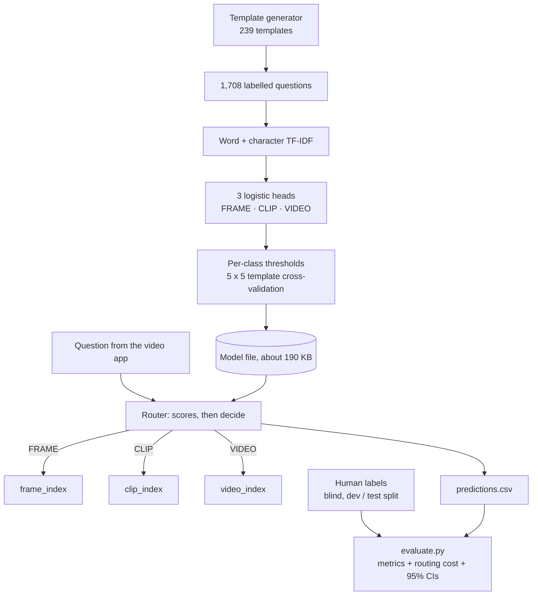

# Workflow and Design Decisions
 
## Literature Review
 
Before building this System, I reviewed work on adaptive retrieval for long videos and on question intent.
 
- **AdaVideoRAG [1]:** routing each question to the right retrieval saves work, but it uses a 7B LLM to decide. I make
  the same decision with a 1 ms classifier.

- **VideoStir [2]:** evidence can be one frame, a clip, or the whole timeline. This gave me three routes: FRAME, CLIP and
  VIDEO.

- **Adaptive-RAG [3]:** a small trained classifier can make the routing call. I trained one.

- **Intent-Driven Dynamic Chunking [4]:** predict the questions users will ask. I generate training questions from
  templates.

- **Multimodal Intent Discovery [5]:** intent must be clearly defined. I wrote an explicit labelling rubric.

- **Video-MME [6]:** the source of the questions. It has answers, not routing labels, so I built my own test sets.

Methods I decided to  incorporate:

- fast n-gram classifiers [7];
- generated data, balanced so no single word predicts a label [8, 9];
- tuned thresholds, validated on held-out templates [10, 11];
- cost-sensitive decisions with calibrated probabilities [12–14];
- standard baselines [15–17] and statistical tests [18–20].

## My Architecture

My first version was a simple, working prototype with word TF-IDF plus seven hand-written keyword rules (appearance, actions, time words, whole-video words and more).And three logistic-regression classifiers, one per route with the same 0.40 cut-off for every route.It was already fast (0.66 ms), but single keywords decided the route, and there were no labels to measure accuracy.

I kept the three-classifier design, the targets and the CPU-only goal, and rebuilt the rest.
 
I built a **small multi-label text classifier**. It reads only the question and returns one or more routes: FRAME (one
moment), CLIP (a short event) or VIDEO (the whole video).
 
It uses word and character TF-IDF features with three logistic-regression heads. It runs on a CPU in about **1 ms**,
from a **190 KB** model, with no GPU, LLM or internet. The questions load straight from the Hugging Face dataset [21].
 
I avoided an LLM on purpose. Even a perfect router would need to answer in under **220 ms** to beat this one on total
cost, and LLM calls take 0.3–2 seconds.
 
## Component Diagram
 

 
 
## How It Works
 
1. **Generate:** 239 templates produce 1,708 labelled questions. Phrases like "in the video" appear under every label,
   so they can't act as shortcuts.

2. **Train:** word and character TF-IDF features feed three logistic-regression heads (scikit-learn [23]).

3. **Tune:** each route gets its own threshold, chosen on templates the model hasn't seen. Every machine gets the same
   result.

4. **Route:** the question becomes three scores, and the router returns every route above its threshold. An optional
   cost policy instead picks the cheapest set that still covers the evidence.

5. **Evaluate:** humans label questions blind, with a development/test split by video. `experiments.py` compares 14
   baselines under the same rules.

## Why These Choices
 
- **No LLM:** about 1 ms instead of 0.3–2 s. The router still ties the best standard classifier (a linear SVM) on
  accuracy.

- **Generated data:** better data alone lifted macro-F1 from 0.762 to 0.882.

- **Learned n-grams, no regex rules:** never worse on any test set, and cheaper routing.

- **Tuned thresholds:** unneeded routes fell from 0.50 to 0.07 per question.

- **New cost metric:** it prices a missed whole-video search above an extra frame lookup. The cost policy cut routing
  regret from 33.5% to 24.7%.

## Design Rules
 
1. The router uses only the question text.
2. Test questions are never used for training or tuning.
3. Labels are collected blind, and Video-MME accuracy stays "pending" until humans label it.
4. Every question gets a route, and uncertain ones are flagged.

## Evaluation
 
 
I tested the router on 163 questions I wrote separately and never used for training.
 
- **Does it pick the right routes?** **0.941** macro-F1, the average score over the three routes (1.0 is perfect).
  The target was 0.85; my first version scored 0.762.
- **Does it miss evidence?** Every needed route is on for **91.4%** of questions, just under the 95% target. Lower
  thresholds (`--threshold-scale 0.3`) reach **95.7%**, with more extra searches.
- **Does it waste searches?** **0.07** unneeded routes per question, down from 0.50.
- **Is it fast and small?** **About 1 ms** and **190 KB**, far inside the 10 ms and 50 MB limits.
- **Is it better than other methods?** It matches the best standard classifier (a linear SVM, 0.935) at about 4× the
  speed, and beats Naive Bayes, k-NN and no router at all.
- **What does routing cost overall?** Compared with a perfect router, it costs **33.5%** extra, or **24.7%** with the
  cost policy. Querying everything costs 137% extra.
- **Is the improvement real?** Yes. The +0.18 gain over my first version has a 95% range of +0.14 to +0.22
  (McNemar p = 7 × 10⁻²⁰).
- **What about real Video-MME questions?** Not scored yet; they need human labels first. The labelling tool is ready
  (`evaluate.py --annotate`).
Results are saved in `artifacts/` and regenerated by `python src/experiments.py`.
 
## References
 
**Research papers**
1. Xue et al. (2025). AdaVideoRAG. arXiv:2506.13589. https://arxiv.org/abs/2506.13589
2. Fu et al. (2026). VideoStir. ACL 2026. https://aclanthology.org/2026.acl-long.1656/
3. Jeong et al. (2024). Adaptive-RAG. NAACL 2024. https://aclanthology.org/2024.naacl-long.389/
4. Koutsiaris (2026). Intent-Driven Dynamic Chunking. arXiv:2602.14784. https://arxiv.org/abs/2602.14784
5. Maharana et al. (2022). Multimodal Intent Discovery from Livestream Videos. Findings of NAACL 2022. https://aclanthology.org/2022.findings-naacl.36/
6. Fu et al. (2024). Video-MME. arXiv:2405.21075. https://arxiv.org/abs/2405.21075
**Methods**
7. Joulin et al. (2017). Bag of Tricks for Efficient Text Classification (fastText). EACL 2017.
8. Wang, Berant & Liang (2015). Building a Semantic Parser Overnight. ACL 2015.
9. Kaushik, Hovy & Lipton (2020). Counterfactually-Augmented Data. ICLR 2020.
10. Lipton, Elkan & Narayanaswamy (2014). Optimal Thresholding to Maximize F1. ECML PKDD 2014.
11. Finegan-Dollak et al. (2018). Improving Text-to-SQL Evaluation Methodology (template splits). ACL 2018.
12. Elkan (2001). The Foundations of Cost-Sensitive Learning. IJCAI 2001.
13. Duda, Hart & Stork (2001). Pattern Classification (Bayes decision rule). Wiley.
14. Zadrozny & Elkan (2002). Transforming Classifier Scores into Accurate Probability Estimates. KDD 2002.
15. McCallum & Nigam (1998). Event Models for Naive Bayes Text Classification. AAAI-98 Workshop.
16. Joachims (1998). Text Categorization with Support Vector Machines. ECML 1998.
17. Yang & Liu (1999). A Re-examination of Text Categorization Methods (k-NN). SIGIR 1999.
18. Efron & Tibshirani (1993). An Introduction to the Bootstrap. Chapman & Hall.
19. McNemar (1947). Sampling Error of the Difference between Correlated Proportions. Psychometrika.
20. Schuirmann (1987). The Two One-Sided Tests Procedure (non-inferiority). J. Pharmacokinetics and Biopharmaceutics.
 
